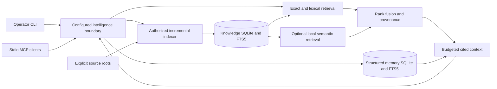

# Intelligence architecture

## Boundary

`quattro_core` is the complete runtime package. It imports no orchestration package, agent framework, desktop, Jev or OmniRoute integration. Runtime dependencies are Python's standard library and SQLite with FTS5. Git supplies optional repository provenance; it is not needed to start or index an ordinary directory. Local Nomic embeddings are optional and separately operated.

## Components

| Module | Responsibility |
|---|---|
| `config.py` | Versioned source/project allowlists; trusted principal; explicit write/verification capabilities; fusion configuration |
| `retrieval.py` | Preserved SQLite retrieval primitives, code/document units, FTS, vectors, graph edges, non-destructive version upgrades and local embedding backend |
| `knowledge.py` | Source ownership, atomic incremental indexing, namespace-restricted fusion, live source freshness, citations, context and explicit legacy import |
| `memory.py` | Transactional memory lifecycle, verification, deduplication, scoped access, fact identity and audit records |
| `mcp.py` | Bounded JSON-lines MCP transport and input schemas; safe errors; no caller-controlled authorization or filesystem roots |
| `cli.py` | Local operator setup, source registration, server launch, queries, health, diagnostics, memory and backups/imports |
| `benchmark.py` | Retained deterministic retrieval-quality benchmark utility, not an execution benchmark |
| `native.py` | Optional native-client context/tool boundary, registered-cwd scope selection and receipt commands; no agent/model/permission control |
| `receipts.py` | Content-free retrieval/delivery records, explicit native/Herdr attribution and diagnostic separation |

## Storage and ownership

Each configured `database_dir` contains `retrieval.sqlite3` and `memory.sqlite3`. Both use WAL, full synchronization and bounded lock waits. Storage directories must be operator-owned/private on POSIX; database files are created mode 0600 **before** SQLite can create journals. Symlink/hardlink database targets fail closed. No live historical database is selected implicitly.

Native integrations additionally use private `native-receipts.sqlite3`, separate from factual memory and preserved historical telemetry. Its records contain operation/session/turn, source coverage and availability, never source/query/conversation text. Context output submission, host-observed message presence and model reliance are distinct states; model reliance is not inferred. See [integration](INTEGRATION.md).

Knowledge adds `knowledge_sources`, `knowledge_files` and `knowledge_documents` ownership tables to the preserved retrieval schema. `legacy_quarantine` records originals without safe attribution. Repository evidence and agent-authored memory remain separate stores and result types.

File updates and removals are one source transaction, including FTS, vectors, file hashes and ownership. A read/embedding/storage failure rolls back source replacement; status records an attempted/failed indexing operation without leaking file content. Unchanged files are not embedded again. There is no queue, daemon, worker pool or execution retry loop.

## Concurrency and portability

Independent clients open independent SQLite connections. Memory deduplication, fact checks, revision checks, supersession and audit writes occur inside `BEGIN IMMEDIATE`. SQLite serializes writers; WAL permits readers. Each connection is used synchronously by its owning process, not shared across arbitrary threads.

Opening an established, complete retrieval schema avoids an immediate writer transaction; a reader can use the prior committed snapshot while another process atomically replaces a source. Schema initialization/migration still takes its own writer transaction.

Source indexing uses POSIX descriptor-relative no-follow opens or native Windows reparse-point opens with ancestors pinned against write/delete sharing. New Windows storage/recovery directories receive a protected operator/SYSTEM/Administrators DACL at creation, inherited by database files and sidecars. Existing directory/file ACLs are validated without rewriting permissions; broad/shared storage directories fail closed. Native containment/ACL regressions run in the Windows CI matrix. Linux runtime is locally verified; Windows qualification is reported separately in the test report. macOS runtime remains unverified.

## Extension boundary

Clients integrate with the documented MCP contract rather than SQL or legacy imports. Storage-specific operations are localized in `RetrievalStore`, `MemoryStore` and the source ownership queries, without a speculative generic ORM. A future PostgreSQL/pgvector adapter must implement those store operations and transactional invariants; SQLite-specific FTS/ranking queries would need adapter work. PostgreSQL support is not implemented or claimed.

Historical desktop sources and helper utilities are retained separately and excluded from the distribution. Existing installed desktop/execution consumers are frozen, not pointed at the incompatible intelligence interface. See [migration](MIGRATION.md).
